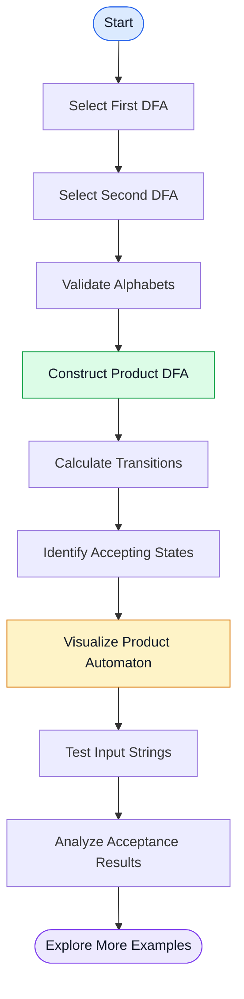
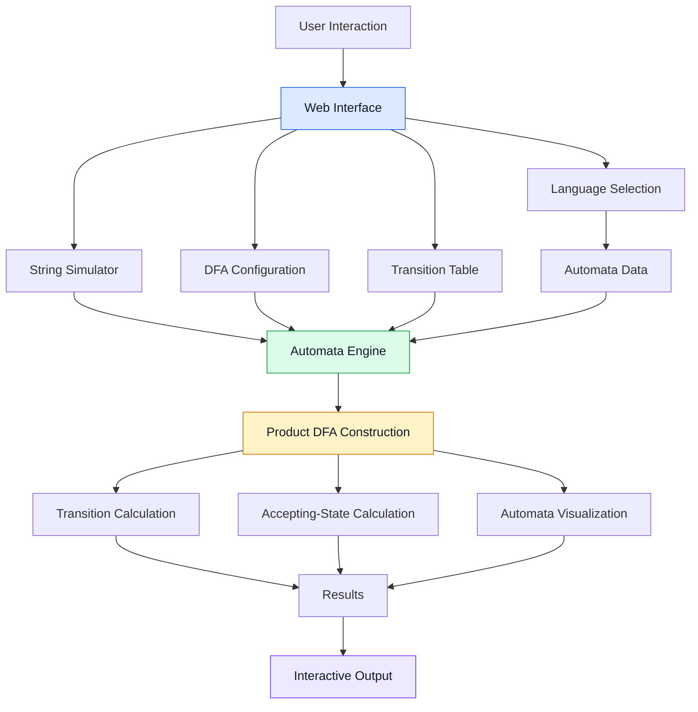

<div align="center">

# ⚡ DFA INTERSECT

### Interactive Regular Language Intersection Engine

**VISUALIZE • SIMULATE • INTERSECT • UNDERSTAND**

<br/>

<a href="https://serene-florentine-5bf4f0.netlify.app/">
  
</a>

<br/><br/>


**An interactive web application for constructing, visualizing, and testing the intersection of two Deterministic Finite Automata (DFAs).**

</div>

---

## 📑 Table of Contents

- [🌟 About the Project](#-about-the-project)
- [🎯 Problem Statement](#-problem-statement)
- [💡 Our Solution](#-our-solution)
- [✨ Key Features](#-key-features)
- [🧠 Mathematical Foundation](#-mathematical-foundation)
- [⚙️ System Architecture](#️-system-architecture)
- [🖥️ Technology Stack](#️-technology-stack)
- [📂 Project Structure](#-project-structure)
- [🚀 Installation Guide](#-installation-guide)
- [📖 How to Use](#-how-to-use)
- [🧪 Example](#-example)
- [📊 Algorithm](#-algorithm)
- [⏱️ Complexity Analysis](#️-complexity-analysis)
- [🎓 Educational Applications](#-educational-applications)
- [🔮 Future Enhancements](#-future-enhancements)
- [🤝 Contributing](#-contributing)
- [📄 License](#-license)

---

## 🌟 About the Project

**DFA Intersect — Interactive Regular Language Intersection Engine** is an educational web application designed to simplify the concepts of Deterministic Finite Automata and regular language intersection.

Developed for students studying **Theory of Computation (TOC)**, the application transforms mathematical automata operations into an interactive visual experience.

Users can explore two automata, investigate their transitions, construct a product DFA, and test strings to understand how the intersection of regular languages works.

Instead of relying entirely on manual calculations, learners can experiment with different automata and observe their behaviour.

### 🎯 Project Objectives

- Simplify DFA intersection through visualization.
- Demonstrate the cross-product construction.
- Explore product states and transitions.
- Understand accepting and rejecting states.
- Test input strings interactively.
- Connect theoretical concepts with practical experimentation.

### 🚀 Try the Live Application

<div align="center">

## [OPEN DFA INTERSECT →](https://serene-florentine-5bf4f0.netlify.app/)

*Explore automata theory through interactive learning.*

</div>

---

## 🎯 Problem Statement

### Regular Intersection Engine

Given two Deterministic Finite Automata, \(M_1\) and \(M_2\), construct a product DFA that recognizes the intersection of their languages.

The resulting automaton must accept a string if and only if both original automata accept that string.

Mathematically:

\[
L(M_1 \cap M_2)=L(M_1)\cap L(M_2)
\]

The main challenge is to:

- Construct product states.
- Calculate transitions for each input symbol.
- Identify the initial product state.
- Determine accepting product states.
- Evaluate input strings using the resulting automaton.

DFA Intersect provides a visual environment for exploring this mathematical process.

---

## 💡 Our Solution

DFA Intersect brings together automata selection, product construction, visualization, and string testing in one interactive workspace.

### 🔄 Application Workflow



### Core Concept

Two automata process the same input string simultaneously.

A product state records the current state of both automata. The product DFA accepts the string only when both automata finish in accepting states.

---

## ✨ Key Features

### 🔗 1. DFA Intersection Engine

Construct a product automaton from two input DFAs using the cross-product method.

### 🎛️ 2. Dual Language Selection

Choose two automata independently to investigate different combinations of regular languages.

### 🌀 3. Interactive Automata Visualization

Explore automata states, transitions, initial states, and accepting states through the application's interface.

### 📋 4. Product Transition Table

Examine the transition relationships of the resulting product automaton.

### ▶️ 5. Input String Simulation

Test input strings and observe whether the resulting automaton accepts or rejects them.

### 🧪 6. Batch String Testing

Where supported, test multiple strings and compare their results.

### 🛠️ 7. DFA Editor

Experiment with supported automata configurations and investigate the effects of changes.

### 📚 8. Theory Guide

Understand the mathematical foundation of product construction and regular language intersection.

### 🧩 9. Language Presets

Explore the predefined automata and language examples available in the application.

### 🔍 10. Product-State Exploration

Inspect product states and their relationships to understand the resulting automaton.

### 📤 11. Export Capabilities

Use the export functionality available in the application to preserve or share results.

### 💻 12. Browser-Based Access

Open the deployed application in a modern browser without requiring a separate desktop installation.

---

## 🧠 Mathematical Foundation

A Deterministic Finite Automaton is defined as a five-tuple:

\[
M=(Q,\Sigma,\delta,q_0,F)
\]

Where:

| Symbol | Description |
|---|---|
| \(Q\) | Finite set of states |
| \(\Sigma\) | Input alphabet |
| \(\delta\) | Transition function |
| \(q_0\) | Initial state |
| \(F\) | Set of accepting states |

Consider two DFAs:

\[
M_1=(Q_1,\Sigma,\delta_1,q_{01},F_1)
\]

\[
M_2=(Q_2,\Sigma,\delta_2,q_{02},F_2)
\]

The product DFA is constructed as follows.

### 1. Product States

\[
Q=Q_1\times Q_2
\]

Each product state is a pair containing one state from each original automaton.

For example:

\[
(q_1,q_2)
\]

represents the situation where the first automaton is in state \(q_1\) and the second automaton is in state \(q_2\).

### 2. Initial State

\[
q_0=(q_{01},q_{02})
\]

The product automaton begins in the pair of initial states.

### 3. Transition Function

\[
\delta((p,q),a)=
(\delta_1(p,a),\delta_2(q,a))
\]

For every input symbol, both component automata transition simultaneously.

### 4. Accepting States

\[
F=F_1\times F_2
\]

More explicitly:

\[
F=\{(p,q)\mid p\in F_1 \land q\in F_2\}
\]

A product state is accepting only when both component states are accepting.

### 5. Language of the Product DFA

The resulting automaton recognizes exactly the intersection of the two languages:

\[
\boxed{L(M_1\cap M_2)=L(M_1)\cap L(M_2)}
\]

This means a string is accepted by the product automaton only if both original DFAs accept it.

---

## ⚙️ System Architecture

The application can be understood through the following logical architecture.



### Architecture Components

| Component | Responsibility |
|---|---|
| Web Interface | Displays the interactive workspace |
| Language Selection | Selects the source automata |
| Automata Data | Provides the configured DFA definitions |
| Automata Engine | Performs automata calculations |
| Product Construction | Creates product states and transitions |
| String Simulator | Evaluates input strings |
| Transition Table | Presents transition information |
| Visualization | Displays automata and results |

*The diagram represents the logical workflow; implementation details may differ.*

---

## 🖥️ Technology Stack

Confirm the exact dependencies in `package.json`.

| Technology | Purpose |
|---|---|
| React | Interactive user interface |
| TypeScript | Type-safe application development |
| Vite | Development server and production builds |
| CSS / Tailwind CSS | Styling, where configured |
| Lucide React | Icons, where configured |
| Node.js | JavaScript runtime |
| npm | Package management |
| Netlify | Live web deployment |

---

## 📂 Project Structure

The following is an illustrative structure. Actual filenames depend on the project files in the repository.

```text
DFA_Intersect-The-Intersection-Engine/
│
├── README.md
├── package.json
├── package-lock.json
├── index.html
├── vite.config.ts
│
├── public/
│
└── src/
    ├── components/
    ├── data/
    ├── types/
    ├── utils/
    ├── App.tsx
    ├── index.css
    └── main.tsx
```

---

## 🚀 Installation Guide

### Prerequisites

Install:

- Node.js
- npm
- Git
- A code editor such as Visual Studio Code

### Step 1: Clone the Repository

Replace the example repository URL with your actual DFA Intersect repository URL.

```bash
git clone YOUR_DFA_INTERSECT_REPOSITORY_URL
```

### Step 2: Open the Project Directory

```bash
cd DFA_Intersect-The-Intersection-Engine
```

### Step 3: Install Dependencies

```bash
npm install
```

### Step 4: Start the Development Server

```bash
npm run dev
```

Open the local address printed in the terminal.

### Step 5: Build the Application

```bash
npm run build
```

The production files are typically generated in the `dist/` directory.

### Step 6: Preview the Production Build

```bash
npm run preview
```

### Common Commands

| Command | Purpose |
|---|---|
| `npm install` | Install project dependencies |
| `npm run dev` | Start the development server |
| `npm run build` | Generate a production build |
| `npm run preview` | Preview the production build |

The commands above assume that the corresponding scripts exist in `package.json`.

---

## 📖 How to Use

1. Open the [DFA Intersect live application](https://serene-florentine-5bf4f0.netlify.app/).
2. Select the first DFA language.
3. Select the second DFA language.
4. Generate or inspect the product automaton using the available controls.
5. Explore its states and transitions.
6. Enter an input string to test its behaviour.
7. Observe the acceptance result.
8. Experiment with other supported automata combinations.

### Understanding the Result

- If both original DFAs accept the input, the intersection DFA accepts it.
- If either original DFA rejects the input, the intersection DFA rejects it.

---

## 🧪 Example

Consider two DFAs operating over the binary alphabet:

\[
\Sigma=\{0,1\}
\]

- **DFA 1:** Accepts strings that start with `0`.
- **DFA 2:** Accepts strings that end with `1`.

Their intersection contains strings that satisfy both conditions.

| Input | Starts with `0` | Ends with `1` | Intersection Result |
|---|---|---|---|
| `01` | Yes | Yes | Accepted |
| `001` | Yes | Yes | Accepted |
| `101` | No | Yes | Rejected |
| `000` | Yes | No | Rejected |
| `111` | No | Yes | Rejected |

### Observation

The intersection language contains strings that begin with `0` and finish with `1`.

This example demonstrates how two independent language conditions can be combined using a product DFA.

---

## 📊 Algorithm

```text
INPUT:
    DFA M1
    DFA M2

OUTPUT:
    Product DFA M

1. Read the states, alphabets, transition functions,
   initial states, and accepting states.

2. Ensure the automata use compatible input alphabets.

3. Construct product states from pairs of source states.

4. Set the initial product state to:
       (initial state of M1, initial state of M2)

5. For each product state (p, q)
   and each input symbol a:

       next_p = transition_M1(p, a)
       next_q = transition_M2(q, a)

       product_transition((p, q), a)
           = (next_p, next_q)

6. Mark a product state as accepting only when
   both component states are accepting.

7. If required, identify and remove unreachable states.

8. Return the resulting product DFA.
```

---

## ⏱️ Complexity Analysis

Let:

- \(|Q_1|\) be the number of states in the first DFA.
- \(|Q_2|\) be the number of states in the second DFA.
- \(|\Sigma|\) be the number of input symbols.

### Maximum Number of Product States

\[
|Q|=|Q_1|\times |Q_2|
\]

### Maximum Number of Transitions

For complete DFAs:

\[
|Q_1|\times |Q_2|\times |\Sigma|
\]

### Time Complexity

Constructing the full product transition table takes:

\[
O(|Q_1||Q_2||\Sigma|)
\]

### Space Complexity

Storing all product states and transitions requires:

\[
O(|Q_1||Q_2||\Sigma|)
\]

These bounds describe the standard full product construction. Reachability-based construction can avoid generating unreachable product states.

---

## 🎓 Educational Applications

DFA Intersect can support:

- Theory of Computation practicals.
- Regular language operations.
- DFA product construction exercises.
- State-transition analysis.
- String acceptance testing.
- Transition table interpretation.
- Classroom demonstrations.
- Practical examination preparation.
- Viva preparation.

### Learning Outcomes

Students can develop a better understanding of:

- How product states are formed.
- How transitions operate on state pairs.
- Why both automata must accept a string.
- How the intersection language is represented by a DFA.

---

## 🔮 Future Enhancements

Potential future improvements include:

- Step-by-step product construction.
- Additional DFA language presets.
- Enhanced automata visualization.
- Exportable transition tables.
- Guided exercises and quizzes.
- Improved accessibility.
- Additional finite automata operations.
- More detailed simulation explanations.

---

## 🤝 Contributing

Contributions, suggestions, and improvements are welcome.

### Contribution Workflow

1. Fork the repository.
2. Create a feature branch.
3. Implement your changes.
4. Test the application.
5. Commit your changes.
6. Push your branch.
7. Open a pull request.

Example:

```bash
git checkout -b feature/new-dfa-preset

git add .

git commit -m "Add new DFA language preset"

git push origin feature/new-dfa-preset
```

Please ensure that changes preserve the mathematical correctness of automata operations.

---

## 📄 License

No open-source license has been specified in this README.

Before distributing the project under an open-source license, add an appropriate `LICENSE` file to the repository.

---

<div align="center">

## ⚡ DFA INTERSECT

### Where Automata Theory Meets Interactive Learning

<a href="https://serene-florentine-5bf4f0.netlify.app/">
  
</a>

<br/><br/>

**VISUALIZE • SIMULATE • INTERSECT • UNDERSTAND**

Made with ❤️ for Theory of Computation learners.

</div>
